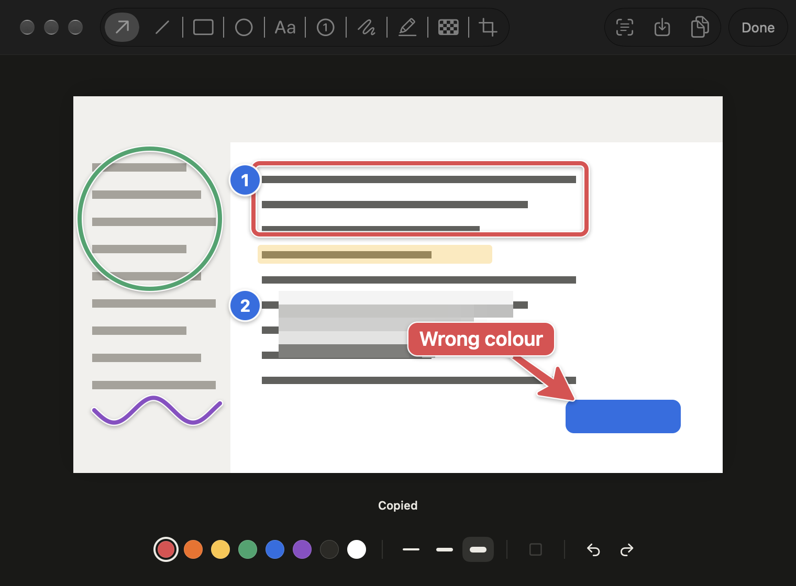

# Shotput

A native macOS screenshot tool built for one loop: press a mouse button, drag an area, paste it
into your agent. Annotate first when the picture needs a pointer.



## Install

Needs macOS 26 or later.

Download `Shotput-<version>.dmg` from [Releases](https://github.com/keshav-exe/shotput/releases/latest),
open it, and drag Shotput to Applications. The current release isn't notarized, so the first
time you open it macOS says it can't check the app. Open **System Settings → Privacy &
Security**, scroll down, and click **Open Anyway**, or clear the flag in Terminal:

```bash
xattr -dr com.apple.quarantine /Applications/Shotput.app
```

To build it yourself instead, you need Xcode's command line tools:

```bash
./Scripts/build.sh --install
```

That builds `build/Shotput.app`, signs it, copies it to `/Applications`, and opens it.

The first launch opens a short guide: a few seconds of Shotput at work, then Screen Recording,
the shortcuts, and setting up a mouse button. Settings → Shortcuts → Show Me How brings back the
mouse button page.

## Use it from a Logitech mouse

Shotput's shortcuts are ordinary system-wide hotkeys, so Logi Options+ can fire them.

1. Open Logi Options+ and pick your mouse, then the button.
2. Choose **Keyboard shortcut** from the actions list.
3. Press the Shotput shortcut you want on that button.

The gesture button takes five actions (click, plus hold and move in four directions), which
covers every shortcut below.

| Action | Default | What happens |
|---|---|---|
| Capture area | ⌃⌥⌘A | Drag an area. It is on the clipboard when you let go. |
| Capture area and annotate | ⌃⌥⌘D | Same, then the editor opens where you captured. |
| Capture window | ⌃⌥⌘W | Click a window. You get it alone, with clean corners. |
| Capture screen | ⌃⌥⌘S | The display under the pointer. |
| Annotate last capture | ⌃⌥⌘E | Opens the most recent capture in the editor. |
| Copy text from area | ⌃⌥⌘T | Drag over text and it is copied as text, read on your Mac. |
| Repeat last area | none | Captures the same area again, with no selection. |
| Annotate clipboard image | none | Opens the image on the clipboard in the editor. |

Change any of them in Settings. Pressing a capture shortcut again while selecting backs out, so
one button both starts and cancels.

Launchers and Smart Actions can also open links: `shotput://area`, `shotput://annotate`,
`shotput://window`, `shotput://text`, `shotput://last`, `shotput://clipboard`,
`shotput://settings`. Turn links off under Settings → General.

## Selecting

- The screen freezes while you select, so open menus and hover states stay put.
- The crosshair snaps to window edges and corners, the menu bar, and the Dock. The guides turn
  blue when snapped. Hold ⌘ to place freely.
- Space switches between area and window. While dragging, hold Space to move the selection and
  Shift to keep it square.
- Esc or a right click cancels.

## After a capture

The image is on the clipboard straight away, so you can paste without waiting. A small preview
then appears in the screen corner nearest your pointer that does not cover what you captured.

- Click it to annotate.
- Drag it into any app as a file, or up to the menu bar to pin it.
- Ignore it and it leaves after a few seconds. It never takes focus.

Settings can open the editor every time instead, or skip the preview and copy quietly.

## Pins

Drag a preview towards the menu bar and a shelf drops out under the Shotput icon. Let go over
it to pin, or use the pin button on the preview.

Click the menu bar icon to open the tray. It holds the last 15 pins in a strip that scrolls
sideways. Click a pin to copy it, Option-click to annotate it, or drag it into any app.
Right-click the icon for captures, Settings, and Quit.

## Annotating

| Tool | Key | Notes |
|---|---|---|
| Arrow | A | Shift snaps to 45° steps. Drag the middle handle to curve it. |
| Line | L | Drag the middle handle to curve it, double click it to straighten. |
| Rectangle | R | Shift for a square. Fill tints the inside. |
| Ellipse | O | Shift for a circle. |
| Text | T | Return finishes, Shift Return adds a line. Double click to edit. |
| Step number | N | Counts up on each click. |
| Pen | P | Sketch a line, arrow, rectangle, or circle and it becomes one. ⌘Z keeps the sketch. |
| Highlighter | H | |
| Redact | B | Mosaic by default. Fill makes it a solid block. |
| Crop | C | |

Keys 1 to 8 pick a colour. Every mark has a thin halo and soft shadow, so it stays readable on
any background, including one of its own colour.

Drag any mark to move it, drag its handles to reshape it, and use the arrow keys to nudge.
Delete removes it.

The toolbar's Background button puts the screenshot on your wallpaper or a colour, with padding,
a soft shadow, and rounded corners. Marks stay where you put them. None takes it off again.

**Return** copies the result and closes the editor. ⌘C copies and keeps it open, and ⌘S saves.
The toolbar can also copy the text in the screenshot, read on your Mac.

## Settings

| Tab | What you can change |
|---|---|
| General | Open at login, the menu bar icon, the capture sound, links, and a reset. |
| Capture | The magnifier, edge snapping, selection hints, what follows a capture, where the preview sits and how long it stays, window shadows, a wallpaper or colour behind window captures, and the pointer in screen captures. |
| Editor | What Esc does, whether ⌘C also closes, turning sketches into shapes, and how text recognition joins lines. |
| Output | Standard resolution, the save folder, saving every capture, PNG, JPEG or HEIC with a quality slider, and a file name template such as `%n %Y-%m-%d %H.%M.%S`. |
| Shortcuts | Every action above, and the mouse button guide. |

## Privacy and footprint

- Sandboxed with no network entitlement. macOS itself stops Shotput from sending anything.
- It can write only to a folder you choose, or a location you pick in a save panel.
- Links can only start captures that put a selection on screen. A silent full-screen capture is
  shortcut only, so another app cannot use Shotput to read your screen.
- Idle, it uses no CPU and about 15 MB of memory. Hotkeys are event driven and nothing polls.
- No dependencies. Swift, AppKit, and ScreenCaptureKit.

## Development

```bash
swift run shotput-dev editor /tmp/editor.png
```

```bash
swift run shotput-dev overlay /tmp/overlay.png
```

```bash
swift run shotput-dev settings /tmp/settings.png
```

The first two drive the editor and the selection overlay offscreen with synthetic mouse events,
check the results, and write renders you can look at. The editor run also tests shape
recognition and curved arrows. `settings` renders every Settings tab, each welcome step, and
frames of the welcome film, and checks that each page fits a small screen.

`preview` renders every kind of mark, `installer` draws the installer window background into
`Resources/Installer`, and `Scripts/make-icon.sh` rebuilds the app icon. All three use the same
renderer as the editor.

## Releasing

The signed, notarized way is from a Mac with your Developer ID certificate:

```bash
./Scripts/release.sh 0.3.0
```

It runs the checks, builds a universal app, signs and notarizes the `.dmg` and `.zip`, then tags
the version and publishes the GitHub release. Notarization needs a keychain profile saved once
with `xcrun notarytool store-credentials shotput`, and the script says so if it's missing.
Versions with a hyphen, such as `0.3.0-beta.1`, become pre-releases.

Pushing a `v*` tag also runs a release on GitHub Actions. Without the Developer ID and notary
secrets listed in `.github/workflows/release.yml`, that build is unsigned, and macOS warns
people the first time they open it.

## Licence

MIT. See [LICENSE](LICENSE).
